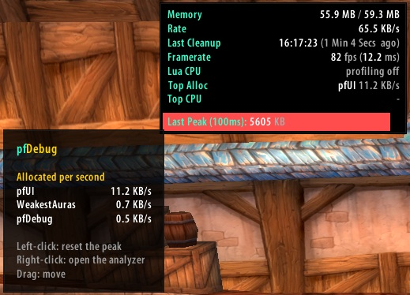

# pfDebug

A Lua memory, garbage and CPU profiler for WoW 1.12. It measures each addon,
frame, event and global function. It needs
[ClassicAPI](https://github.com/brues-code/ClassicAPI).

## Widget

The widget shows the Lua memory, the allocation rate, the last garbage
collection, the frame rate, the Lua CPU time per second, and the addons that
allocate the most memory and use the most CPU. The bar shows the largest
allocation in a tenth of a second. It drains in 5 seconds, and then the next
allocation becomes the new peak.

- Left-click: reset the peak bar
- Right-click: open the analyzer
- Drag: move
- Hover: the top addons by allocation and by CPU

## Analyzer

`/pfd` opens the analyzer. Each tab is a sortable, searchable list. Hover a
row for details. Right-click a row for actions such as highlight, inspect
(TableInspector) and copy. **Copy** puts the shown rows on the clipboard as
plain text.

- **Addons**: memory, allocations per second, peak allocations, CPU time per
  second, CPU share and total CPU time. Click an addon to see its frames.
- **Frames**: every frame that runs scripts, with its owner addon, CPU time,
  calls, time per call and allocations. The tooltip shows where the frame was
  made, its OnUpdate and OnEvent handlers, and its most expensive events.
- **Events**: how often each event fires, how many frames listen to it, and
  the CPU time and allocations of its handlers. The tooltip lists the
  listeners by cost.
- **Globals**: the global tables, functions and frames each addon made, and
  the ClassicAPI functions that something replaced or hooked. With
  **Show FrameXML** and CPU profiling, it shows the cost of every game API
  function.

## Measurements

- **CPU profiling** (`scriptProfile`) is needed for CPU times. The button at
  the top right sets it and reloads the UI. Profiling makes each Lua call
  slower, so turn it off when you are done.
- **Deep tracking** hooks the intrinsic precall and postcall of every OnUpdate
  and OnEvent script. It measures the memory each frame allocates and the CPU
  time and memory of each event. The hooks never replace a handler. They
  stay until `/reload`.
- **Reset** sets all CPU times, call counts, allocations and event counts to
  zero.

With ClassicAPI_DebugTools loaded, `/fstack` also shows the owner, script CPU
time and allocations of the highlighted frame.

## Commands

- `/pfd`: toggle the analyzer
- `/pfd widget`: toggle the widget
- `/pfd reset`: reset the counters
- `/pfd profile on|off`: turn CPU profiling on or off (reloads the UI)
